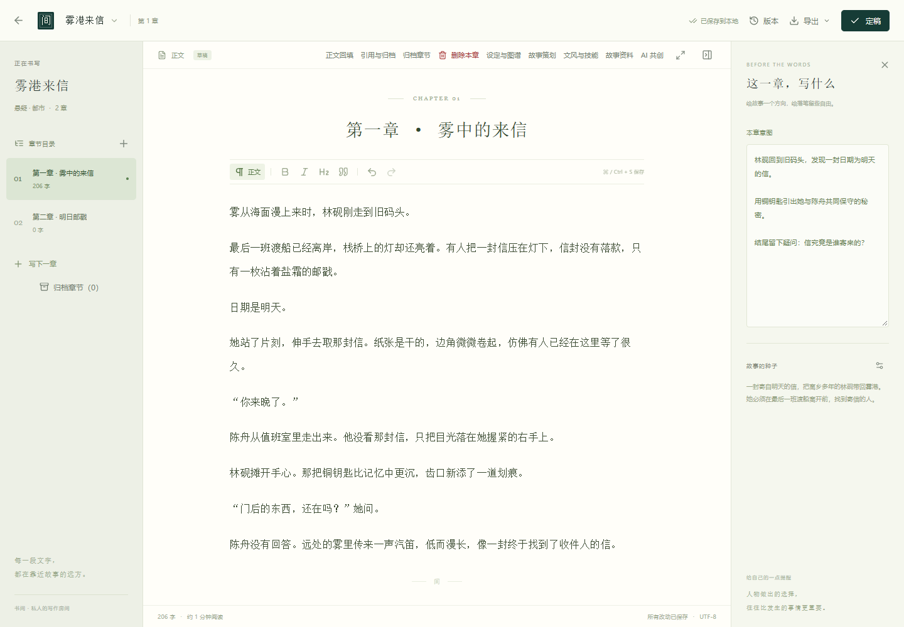
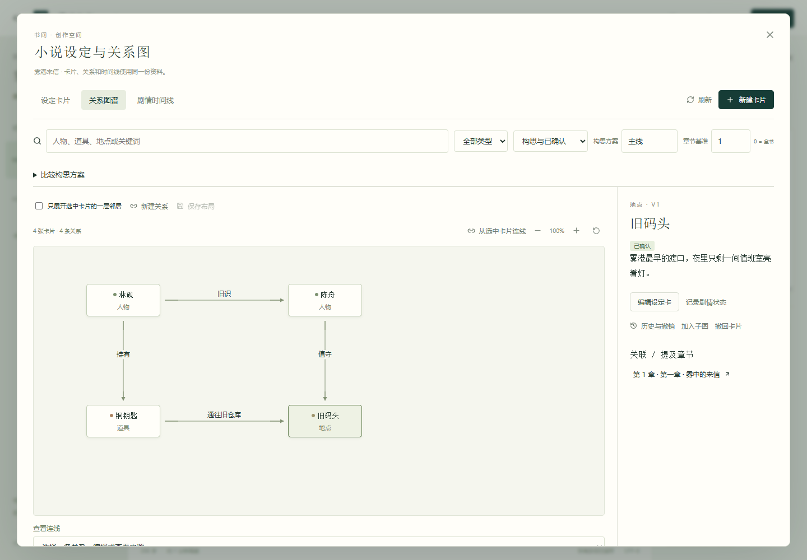

# 书间 · AI Novel Pro

作者掌舵的本机中文小说工作台。讨论设定与剧情，逐章生成、修改和定稿；作品及历史保存在本地。

支持 SQLite 或 PostgreSQL、多套 OpenAI Chat Completions 兼容 API，以及正文回填、设定卡和关系图谱。小说、版本和配置由你掌握。

## 界面预览

以下为独立演示库的实际界面截图，使用虚构小说和设定，不包含个人作品或模型凭据。


| 正文编辑与本章计划 | 设定卡与关系图谱 |
| --- | --- |
| [](docs/screenshots/editor.png) | [](docs/screenshots/atlas.png) |

## 最近更新

| 能力 | 使用方式 |
| --- | --- |
| 正文回填知识与图谱 | 定稿后打开“正文回填”，预览费用，按章分析，再确认实体匹配、原文证据、关系和状态；[操作指南](docs/BACKFILL_GUIDE.md) |
| 删除、引用与归档 | 删除前自动备份；被引用章节可查看依赖、归档及取消归档，保留出处与历史 |
| 备份管理 | 本地备份列表、恢复预览、保留周期与清理确认，保护最后一份作品、章节及版本副本 |
| 更轻的首屏与移动端 | 编辑器和工具面板按需加载；书架入口 JS 约 245 KB，移动端次要功能收进工具菜单 |

## 启动

需要 Node.js 24 与 pnpm 11。

```bash
git clone https://github.com/Rayz3rk/ai_novel_pro.git
cd ai_novel_pro
pnpm install --frozen-lockfile
pnpm build
pnpm start
```

打开 http://127.0.0.1:4318 。Windows 也可双击 `start.bat`；开发模式为 `pnpm dev` 或 `start-dev.bat`，前端地址 http://127.0.0.1:5173 。停止时在终端按 Ctrl+C。

## 功能

- 书架、章节、正文编辑、自动保存、版本检查、应急副本与冲突稿导出。
- 小说和章节删除、引用明细、章节归档与恢复、删除前自动备份、空作品新增章节。
- 备份管理、恢复预览、容量统计、保留周期和清理预览；按需加载的编辑器及工具面板。
- 留稿、版本恢复、作者定稿、TXT/Markdown 导入导出与完整 JSON 备份恢复。
- 多平台连接、讨论、分层规划、候选起草、选区改稿、差异查看与明确采纳。
- 持久任务、流式进度、取消、重试、断流文字保留、实际输入与费用记录。
- 资料证据、角色知情范围、旧章影响提示、创作技能、人物声音与作者偏好案例。
- 人物、地点、道具、组织、场景及便签卡；关系图、方案对照与章节状态时间线。
- 子图讨论/起草、出处回查、历史撤销；AI 关系建议先作为待确认构思。
- 从定稿批量提取知识、关系和状态，匹配实体、预览证据与差异后确认回填；定稿更新后增量分析。见[正文回填指南](docs/BACKFILL_GUIDE.md)。

模型输出不会自动变成正文或正式事实。所有生成由使用者发起；预览材料本身不调用模型。

## 配置与隐私

日常使用只连接一套作品数据库：SQLite 与 PostgreSQL 二选一，不会按小说创建多个数据库。默认 SQLite，数据为 `data/workspace.sqlite`。数据库与模型连接配置位于项目父目录的 `novel-private/`，不放进源码仓库。

- 模型配置：参考 `config-examples/connections.example.json`，保存为 `../novel-private/connections.json`，或在“模型连接”界面设置。
- 数据库配置：参考 `config-examples/database.example.json`，保存为 `../novel-private/database.json`。
- API 密钥保存于 `../novel-private/credentials/`，不进入作品数据库和应用备份。
- 作品、配置、备份、日志、测试输出、参考源码副本和本机审计由 `.gitignore` 排除；发布前仍须检查实际提交文件。

连接模型时，所选正文和资料会发往配置的平台。备份及冻结评测样本可能含有作品，应按私人文件保管。

## 开发与测试

旧版 `ai_novel` PostgreSQL 小说库可在停止当前服务后执行 `pnpm import:legacy -- "D:/projects/ai_novel"` 导入。工具读取旧项目 `.env` 的数据库连接，在事务中导入小说、草稿、正文版本和设定，重复执行会跳过已导入作品。源快照、导入前备份及报告保存在 `data/backups/legacy-import-*/`。不会导入旧模型密钥；旧审阅和运行日志保留在源快照中。

书架上的“删除作品”需要输入作品名称；编辑器中的“删除本章”会先保存当前草稿。删除前的备份可直接在“备份管理”中预览、下载和恢复，也保存在 `data/backups/before-delete/`。正在执行 AI 任务时不能删除；章节若被资料、规划或 AI 历史引用，可通过“引用与归档”查看具体来源并归档，原文与出处会保留。删除和归档都不重排故事序号。移动端从“工具”打开这些功能。

“备份管理”支持立即备份、容量统计和保留设置。0 天表示永久保留；其他天数用于生成过期备份清理建议，预览后手动确认清理。每部作品、章节和历史版本的最后一份备份受到保护。源快照、无法识别及损坏的文件不会参与清理。含归档章节的新备份请使用更新后的书间恢复。

```bash
pnpm typecheck
pnpm test
pnpm build
pnpm eval:creative
```

测试使用隔离数据库和固定模型样本。默认测试使用临时 SQLite；只有显式启用 `NOVEL_TEST_POSTGRES=1` 才会创建隔离 PostgreSQL 测试库，测试结束后自动删除本轮创建的库，清理失败会使测试报错。不会对正式作品库重置表或运行写入测试。浏览器脚本见 `tests/e2e/`，需要 Python Playwright；可用 `NOVEL_TEST_URL` 和 `PLAYWRIGHT_CHROMIUM_EXECUTABLE` 指定地址和浏览器。不要针对个人作品库运行写入测试。

README 截图可在安装 Python Playwright 后重新生成；脚本会创建独立演示库，并在结束时关闭测试服务：

```bash
python scripts/run-ui-tests.py tests/e2e/readme_screenshots.py
```

Windows 发布构建为 `pnpm release`，输出到 `artifacts/`。仓库只保存源码与发布脚本，不包含配置、作品或构建包。

## 文档

- [整体规划](docs/PROJECT_PLAN.md) · [实现说明](docs/IMPLEMENTATION.md)
- [数据库与迁移](docs/STORAGE.md) · [Windows 说明](docs/PORTABLE_GUIDE.md)
- [基础 API](docs/M1_API.md) · [AI API](docs/M2_M3_API.md) · [图谱 API](docs/ATLAS_API.md)
- [创作技能](docs/CREATIVE_GUIDE.md) · [设定与关系图](docs/SETTING_GUIDE.md)
- [离线评测](docs/QUALITY_COMPARISON.md) · [功能验收](docs/ACCEPTANCE.md)
- [参考项目与取舍](docs/REFERENCES.md) · [更新记录](CHANGELOG.md)
- [本轮优化结果](docs/OPTIMIZATION_RESULT-2026-11-11.md)
